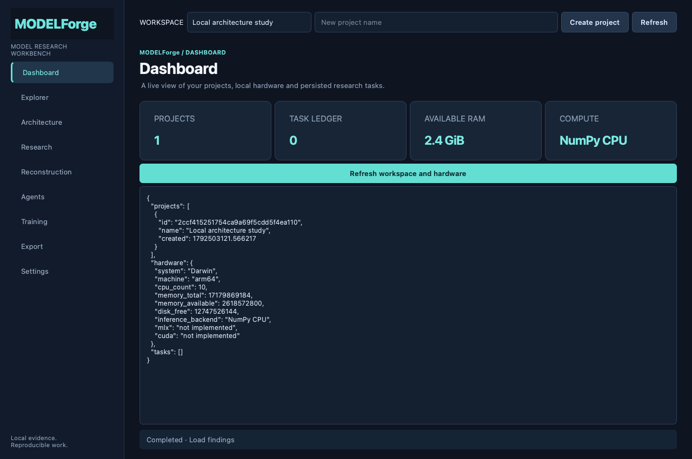

# ModelForge

An open-source desktop workbench for evidence-based AI model research. Inspect local model files, run authorized API experiments, execute supported local language models, train adapters or full weights, and retain reproducible findings.

**0.2.0 adds real local GPT-2/Llama execution and Apple Silicon MLX experiments.** Supported architectures and complete local weights are required. Closed-model outputs do not reveal original weights, and “Universal Model Reconstruction Research Engine” (UMRRE) names a research objective rather than an achieved universal cloning capability. Read the [capability matrix](docs/capabilities.md).



## Install and run

For a native app, use the archive matching your system on [GitHub Releases](https://github.com/m2gsg7rf22-cmd/model-forge/releases). The desktop base includes the original CPU fixture workflow. Optional language engines run in a separate environment; they are not all bundled into the app. In **Settings → Optional local engines**, select an engine and explicitly authorize installation, or supply an existing compatible Python interpreter. The installer requires `uv` or Python 3.12+, network access and at least 3 GiB free disk. It downloads libraries, not pretrained model weights.

Source installation requires Python 3.12+:

```sh
git clone https://github.com/m2gsg7rf22-cmd/model-forge.git
cd model-forge
python3.12 packaging/install.py --prefix "$PWD/.venv"
.venv/bin/python -m pip install '.[llm]'
.venv/bin/modelforge gui
```

On Apple Silicon, use `'.[llm,mlx]'` for both engines. Windows uses `py -3.12` and `.venv\Scripts\python.exe` / `.venv\Scripts\modelforge.exe`. Optional model packages are substantial downloads. See [installation](docs/installation.md), [local runtime](docs/local-runtime.md) and [MLX](docs/mlx.md).

For installation directly into Claude Code or Codex:

```sh
python3.12 packaging/bootstrap.py install --prefix "$HOME/.local/share/modelforge-agent" --client claude
```

Use `--client codex` for Codex. This creates a dedicated environment, verifies actual MCP calls and prepares integration files. Add `--apply --project /absolute/project --scope local` to register the dedicated integration; Codex registration is user-level. Optional flags are `--desktop` and `--engines llm mlx`. See the complete [agent installation, update and removal guide](docs/agent-install.md).

## Run a local example

```sh
.venv/bin/modelforge --home ./local-data local-example --destination ./local-example.zip
```

With the `llm` extra installed, this creates owned random Llama weights and a local tokenizer, generates actual tokens, trains LoRA on synthetic text, reloads the adapter, merges it with explicit redistribution rights and exports the reconstructed model. No external weights or training datasets are downloaded. Random tiny models test correctness; they do not demonstrate useful language quality.

The lightweight original workflow remains available with `example --destination ./example-export.zip`. It uses an independent NumPy byte-token model and trains its output head.

## What works

- Nine PySide6 pages, background workers, local model and training tabs, durable API experiment controls and visible failures.
- Bounded SafeTensors/GGUF and HF metadata inspection; optional ONNX/Core ML metadata. Python and pickle model files are refused.
- Local built-in GPT-2/Llama SafeTensors loading with exact inventory checks, CPU inference and available Torch MPS/CUDA devices. Only CPU and MPS tiny-model execution have been locally verified for this development version.
- Actual full-weight and PEFT LoRA training, immutable checkpoints and deterministic HF resume. CUDA/bitsandbytes QLoRA is guarded but unverified on the available machine.
- Apple Silicon MLX Llama inference, real 4/8-bit linear quantization, measured CPU/GPU comparison, LoRA and quantized-base LoRA training with saved-adapter reload. Tiny owned fixtures were exercised on the available GPU; this is not large-model acceptance.
- Forward-hook activation statistics and reversible named-MLP ablation, with numeric logits/KL measurements and no semantic neuron claims.
- UMRRE controlled affine recovery, nonidentifiability witnesses, neural symmetries, held-out approximation and actual compression experiments.
- Durable authorized API request/output-token ledgers, JSON Schema checks, explicit-label scoring, context retrieval cases and resumable experiments.
- Persistent projects/findings/jobs, real MCP tools, Claude Code/Codex integration and isolated bootstrap lifecycle.

Image/video/audio generation, arbitrary remote-code model loading, GGUF execution, universal architecture discovery and proprietary weight recovery remain unsupported. [Capabilities](docs/capabilities.md), [research evidence](docs/research-evidence.md) and [release notes](docs/release-notes.md) distinguish implementation from measured validation.

## Evidence and rights

API observations establish behavior for those requests, not architecture or weights. Finite reconstruction parity checks establish tested numerical agreement, not equivalence for all inputs. Training loss alone does not establish held-out quality.

Use only authorized files, corpora and endpoints. Provider outputs never enter training automatically. Attached source models stay external. Export includes reports, original generated assets and explicitly authorized reconstructed HF bundles; raw attached weights and training-checkpoint trees are not automatically copied. Review local paths and provider outputs before sharing. API keys come from `MODELFORGE_API_KEY`, not saved settings.

The [validation record](docs/validation.md) preserves historical v0.1 checks. Focused v0.2 engine tests are separate from final release/CI acceptance; do not interpret a historical green run as certification of new packages.

## Development

```sh
python3.12 -m venv .venv
.venv/bin/python -m pip install -e '.[desktop,dev,onnx,llm]'
.venv/bin/python -m pytest -q
.venv/bin/python -m mypy src/modelforge
.venv/bin/python -m ruff check src tests packaging
```

[User guide](docs/user-guide.md) · [API](docs/api.md) · [MCP](docs/mcp.md) · [Training](docs/training.md) · [Research lab](docs/research-lab.md) · [UMRRE](docs/umrre.md)

Original implementation is MIT licensed. Dependencies retain their own licenses; source or weights from researched projects are not vendored. Native builds include dependency notices.
