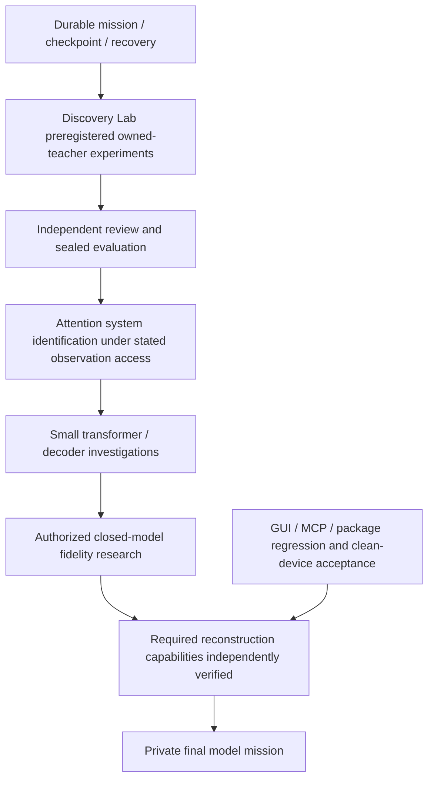

# ModelForge dependency roadmap

This is an unresolved research mission, not a promised universal algorithm. Stable baseline: v0.2.0, tag 952450a; accepted engineering and explicit limitations are in acceptance-v0.2.0.he.md. Experimental branch: discovery-lab. Private final model creation is BLOCKED by the user's prerequisite, not by a temporary missing button.

Priority queue:

1. Durable state/append-only ledger: crash recovery, lock ownership, Git ancestry, no automatic execution of persisted command strings. Verify before using it as a scientific source of truth.
2. Discovery Lab: separate teacher preparation, allowed learner observations, fixed validation, one-time sealed heldout evaluator, model/source commitments. Start with nonlinear quadratic families, richer real-valued observations and insufficient sign-only controls. No claim of transformer reconstruction.
3. Independent verification agent: challenge leakage, seed exposure, repeated evaluation, fabricated independence, numerical exactness and resource assertions.
4. Advance to known small attention mechanisms: characterize Q/K gauge symmetries, rank and observation requirements. Pre-register comparison of output-only vs legitimately exposed activations; never assume arbitrary text endpoints expose logits.
5. Improve actual MLX full-prefix baseline through bounded KV-cache experiments. Compare exactly the same tokenizer, model, decoding, seed, warmup, numerical error, tokens/sec and sampled RSS. No new large model download or heavy training until a discriminating experiment is designed.
6. Discovery/resume GUI and CLI/MCP integration; resource limits, cancellation and persistence. Independent GUI workflow tests; visible clean-device Gatekeeper remains unverified.
7. Heldout broad model evaluation/dataset provenance, then owned small transformer research, architecture families, nonlinear identifiability and permitted knowledge transfer. External target credentials, identity, license and spend authorization are explicit dependencies, not assumed access.
8. Image/video/audio and MoE only after language-model research infrastructure; not implemented by metadata inventory.
9. Private final model: BLOCKED. Target 'Luna 5.6' has no unambiguous provider/model ID/evaluation reference yet. No private weights or implementation will enter public Git. No benchmark parity or frontier label is justified. Gate cannot open on a passing software suite or a signed report alone; underlying scientific scope must actually be achieved and independently checked.

Scientific outcomes must be classified ENGINEERING COMPLETE / SCIENTIFICALLY PROVEN (under explicit assumptions) / RESEARCH IN PROGRESS / UNRESOLVED. Last two are not failures to be hidden. No scheduling or execution outside an active session is implied by this graph.

## 2026-10-24 main-platform update

The isolated continuous-query antipodal **even component** route is implemented and sealed-tested, with an explicit failing bias control and independent protocol review. See docs/antipodal-reconstruction.md. This stronger observation access is not implied by O3 data or final text/logits. Full gate/coupling discovery, odd component, attention composition and arbitrary-model recovery remain open. Preserve the sealed SwiGLU v1 failure; preregister iteration-budget v2 before fresh teachers. Historical private-model work does not open the final prerequisite.

Isolated GLU full-map development now has a positive owned width64/d32 pilot, independent multiscale checks and explicit quartic-flatness diagnosis. Advance to preregistered fresh-teacher replication before integration. Keep O3 finite observations, isolated continuous queries and final text/logits as distinct access regimes. This changes the next experiment, not the universal objective or closed private gate.

Fresh isolated GLU v1 failed engineering before sealed evaluation (stdout/file contract). Preserve the failed run and do not infer scientific failure from initial direction counts. V2 keeps methods/thresholds fixed and adds tested transport; require independent source review and a newly committed readiness certificate before3fresh teachers. See docs/isolated-glu-sealed.md.

Actual v2 all3 criterion FAILED (63/64/64 candidates). Two fresh .2/.4teachers passed registered finite-domain/parameter criteria; .1stopped before truth evaluation. Candidate discovery completeness is now the measured bottleneck. Prioritize calibration-only residual/subspace-guided coverage research, followed by a new frozen protocol and fresh sealed evaluation. Full Transformer/universal reconstruction and private final-model gate remain unmet.

2026-10-24 candidate coverage development: a distinct calibration-only tangent/residual initializer produced one extra nonduplicate direction (63→64) using only saved public v2 teacher0 Hessians/directions, zero new queries. Original-subspace loss4.70e-17; no private teacher match or functional/heldout check. Independent geometry controls show that residual dimension/energy and a single tangent singular minimum cannot certify coverage. Source examples/isolated_glu/coverage.py; docs/isolated-glu-coverage.md; evidence experiments/evidence/isolated-glu-coverage-development-v1/. Three synthetic tests/types/lint pass. Formal v2 remains FAILED; no consumed labels reused. Next implement/review/freeze DISTINCT fresh-teacher v3 protocol; experiments/preregistrations/isolated-glu-fullmap-v3-rescue-draft.json is DRAFT/NOT READY. Private final-model gate remains CLOSED.

2026-10-25 v3 source/protocol ready for cross-platform checks: examples/isolated_glu/sealed_v3.py and experiments/preregistrations/isolated-glu-fullmap-v3.json are separate from frozen v2. Fixed63rescue/64skip/othersfail;128rescue starts, no new oracle calls. Base outputs, rescue outputs and branch are sealed; original-V losses and exact selection are recomputed. Independent source/protocol review closed two audit findings;9changed-path tests, strict mypy/Ruff passed. Evidence experiments/evidence/isolated-glu-v3-runner/. No fresh v3 teachers yet; run targeted12-test CI (v3+coverage), then committed readiness check before entropy. V2 FAILED remains unchanged; private final-model gate CLOSED.

2026-10-25 actual v3 FAILED: fresh teachers60/62/61directions, all rejected before63-only rescue/coupling/heldout.436320calibration/0sealed calls, sourcea0d0556; independent public negative-outcome audit completed. CI40162660787 passed12changed-path tests on each OS; no native rebuild. Separate multi-direction public-calibration development then obtained60→64,62→64,61→64 in one fixed512start round each (3.72/3.39/3.23s, sampled RSS≤104972288bytes). All candidates/initializations/selection independently audited; no private truth/heldout. Frozen multiscale solver integrated on public observations, finite rank-one outputs and calibration consistency audited. Two NEW local synthetic tests/types/lint pass for coverage_multi.py; that new script has no cross-platform CI yet. Formal v3 remains FAILED;64counts/calibration fit do not certify true coverage/fullmap. See docs/isolated-glu-multi-coverage.md and experiments/evidence/isolated-glu-multi-coverage-development-v1/. Next implement/review/freeze DISTINCT v4 multi-rescue wrapper; experiments/preregistrations/isolated-glu-fullmap-v4-multi-draft.json is DRAFT NOT READY. Private final-model prerequisite CLOSED.

2026-10-25 v4 frozen source/readiness: sealed_v4.py adds fixed1..63multi/64skip to frozen coverage_multi.py, max4roundsx512starts. Every round's prefix/losses/merge/seeded starts/report geometry and inventory audited; final64required with no truncation. Independent review approved after closing geometry-report gap,2/3/4round synthetic audit probes passed;15local changed-path tests/types/lint passed. Source/protocol/review/readiness must be committed unchanged before entropy. Run targeted17test v4+multi CI on3OS, then new3teacher v4 once. No fresh v4 teachers yet; v1/v2/v3 failures preserved, private final-model prerequisite CLOSED.

2026-10-25 actual v4 PASSED all3registered finite-sample criteria on fresh owned isolated FP64 SwiGLU blocks. Base61/60/62→64 each via one512start multi-rescue round;436320cal+6144sealed=442464vectorcalls;26.0751scontroller, maxsampled348717056bytes (~332.56MiB). Max scale-group Frobenius relative error1.1527661335e-4; maxabsolute9.0871620648 is retained. Independent public outcome audit verified commitments, public fit audit and numeric threshold logic without rereading private labels or refitting. Sourcefad2ffe, CI40163909186 passed17changed tests each3OS. See docs/isolated-glu-v4-result.md and experiments/evidence/isolated-glu-fullmap-v4/. This is3isolatedd32/width64/out32bias-free FP64 cases, not universal/fullTransformer/originalstoredweight/allinputs proof. Oldfailures preserved and consumedlabels maynotbeusedagain. Next deliver actual packaged glu32 candidate backend/CLI/MCP and installed skill route; plan docs/superpowers/plans/2026-10-25-glu32-candidate-backend.md. The fullGLU experimental Python path is NOT YET a supported backend/MCP operation. Subsequent precision/access/scaling research remains open; private final-model gate CLOSED.

2026-10-25 packaged GLU32 delivery COMPLETE (component engineering only): source84ce720, independently reviewed pure-NumPy kernel/strict IO/bounded worker/service/CLI/MCP/reload/export. Actual clean installed-wheel CLI/MCP passed without PYTHONPATH/heavy engines; independent installedCLI17newpublic inputs matched frozen public candidate exactly. Local25tests and CI40167761243 each Linux/macOS/Windows25passed,0failed,0error,0skip, plus changed-source types/lint. No native rebuild/new stable release/GUI verification. Rejected operations cannot predict/export; accepted artifacts bound to success-record manifest hash. Installed and bundled skills synchronized/validated. Exact contract skills/model-forge/references/glu32.md; engineering/evidence docs/glu32-candidate-backend.md and experiments/evidence/glu32-candidate-backend/. Candidate flags remain uncertified; this ports prior finite isolated FP64 v4 science, not new sealed proof. Next preregister finite-precision/rounding step-size tradeoffs, bias controls, dimension/width/HVP scaling and missing final-output-to-block reduction. O3 iteration-budget study remains separate. Consumed labels/private assets untouched; universal reconstruction unresolved and private final-model gate CLOSED.

2026-10-25 precision development checkpoint: reviewed sourcee6bc6f4 ran one fixed PUBLIC seed572041 d32/w64/o32 sweep,6488064vectorcalls/48rows,7.6228455s,187596800byte sampled process-tree peak(128samples),180s/512MiB caps. Original centralh.003 actualNumPyFP32 H-relative error2.13245/gap1.0018; h.3Richardson improves to.000304422/gap797.35/RMSsubspace-sine.000104614. ReturnedFP32 is distinct: h.3R error9.1928e-5/gap1389.86. ReturnedFP16 all12options gap<100(best9.1176). SmallhRichardson amplifies rounding noise; retain all48outcomes. Source/reference-gap fix and outcome independently audited;5NEW local tests/type/lint pass, no new3OS or recovery claim. Evidence experiments/evidence/isolated-glu-precision-development-v1/; docs/glu-precision-development.md. No rawHpersisted: audit verifies source/formula-controls/grid/ratio consistency, not a raw-array Herror/angle recomputation. Next DISTINCT public full-map FP32development pilot: freezeh.3R, sameFP32channel for everyH/multiscale/even observation, persist calibration arrays, use frozenlearner with strictfailures; do not relabel as supportedFP64productionprofile or sealed evidence. New fresh-teacher precision/scaling protocol, bias controls/HVP and final-output reduction remain open; universalgoalactive/privategateCLOSED.

2026-10-25 consistent-channel FP32 full-map public pilot REJECTED. Reviewedsource8d2d457;280608actualFP32calibration vectorcalls,14.763533166scontroller, maxsampledworker-treeRSS164216832bytes(prepare4samples/fit223samples). Fit rejected at directions: Multi-rescue failed exactly64candidate requirement. No candidate/eval/heldout, exclusivefit-attempt preserved; no retries/thresholdchanges/mixedFP64data. Independent outcome audit verified savedfine/coarse/Richardson equality/shapes/finiteness/symmetry/hashes/provenance; independent savedH SVDgap797.34824. Exactfinalcandidatecount was NOTsaved, so undercount vs overcount is UNKNOWN. Successfulcurvature diagnostic did NOT establishFP32fullmap recovery.4NEWlocalwrappertests/type/lint passed; no newCI/nativebuild/privateassets. Docs/glu-fp32-fullmap-development.md and experiments/evidence/isolated-glu-fp32-fullmap-development-v1/. Durable52MBcalibration remains under ~/.local/share/modelforge-research/experiments/fp32-fullmap-dev-v1-20261025-8d2d457/public, excludedGit. Next saved-calibration noise/rejection diagnostics; if exactcounts require replay, use a DISTINCT independentlyreviewed public telemetry protocol/uniqueoutput and disclose it as replay, not independentreplication; do not rerunreservedfailedfit. Fullprecision/scaling/bias/HVP/wholemodelaccess remain open; universalgoalactive/privategateCLOSED.

2026-10-25 saved-FP32 disclosed telemetry replay completed: reviewedsource9e5c51f, one direct frozen directions call/0newtargetqueries,16.508504625scontroller, worker-tree sampledpeak215072768bytes/254samples. Newreplayinitial256starts→52retained, four512startrescue rounds52→52, final52undercount; not a retrospectively logged originalcount or52true-gateidentityproof. Independent outcome audit recomputed52initialselection bitwiseequalfinalknown, unit/duplicate/loss guards and savedSVD/angles; all9originalfiles unchanged. Individual2048rescuearrays notsaved, so auditcannotrecompute everydiscarddecision. No model/eval/student; originalFP32pilot remainsREJECTED and FP64productionunchanged.3NEWlocaltests/type/lint pass, no newCI/native/privatework. Evidence experiments/evidence/isolated-glu-fp32-count-diagnostic-v1/; docs/glu-fp32-count-diagnostic.md. Durable telemetry outsideGit: ~/.local/share/modelforge-research/experiments/fp32-count-diagnostic-v1-20261025-9e5c51f/diagnostic/telemetry.npz (SHAe043e538a58187a9171a997bc889da2c0ab7518ffb99badc75fa1bc53c8fe6a9). Next distinct READONLY residual/cluster sensitivity onstoredrefinedv/losses, no optimizerreplay/newqueries/candidateacceptance; distinguish cutoff sensitivity from unknownbasin coverage. Futuremethod/thresholdneedsprospectivereview,calibrationchecks,freshsealedprotocol; no automatictruncation. Universalgoalactive/privategateCLOSED.

2026-10-25 readonly residual-sensitivity COMPLETE: reviewedsourcef826ff4,14fixedcutoffs,0optimizer/targetqueries/teachertruth/eval/model. Counts0,0,1,12,52,64x9; baseline1e-8→52 andfirst64at3e-8. IMPORTANTall256losses≤2.87843124168e-8, so9rowterminalplateauisfinite-pool saturation, NOTnoise/coveragevalidation. WidestplateauproposalWITHDRAWN beforeimplementation. Independent audit recomputedall14selections/guards/hashes andunchangedinputinventory.4NEWlocaltests/type/lint pass; .130781625scontroller,37928960byteworker-treepeak/2samples; no newCI/nativebuild/privateassets. Evidence experiments/evidence/isolated-glu-fp32-residual-sensitivity-v1/; docs/glu-fp32-residual-sensitivity.md. Next DISTINCTprospective all-pool hypothesis-generation pilot: noresidualacceptanceclaim, greedyall256thenexact64widthguard/no truncation, unchangedFP32multiscaleguards, separatePUBLIC2048point evalonlyifcandidate, review/freezeBEFOREexecution. No oldfitretry/criterionchange/productionFP32claim. OriginalFP32rejection preserved; universalgoalactive/privategateCLOSED.

2026-10-25 all-pool FP32candidate built BUTqualityFAILED. Reviewedsource92ea993, explicitnewuncut-poolhypothesis→64/no truncation; frozenmultiscaleranks2048/64/64 positive; separatePUBLIC2048point eval(seed941027)all4relativeerrors .00250529/.00257213/.00254897/.00261527 >registered.001; maxabs272.2189293retained. Do notequate public_candidate_evaluatedstatus toqualitysuccess.1.707790375scontroller, maxsampledworker-tree232882176bytes,0newcal/0directionoptimizations/1multiscalefit. Independent saved-array audit recomputedmetrics/independentforward/commitments withoutteacherqueries/refitting;13oldfilesunchanged.5NEWlocaltests/type/lint pass, no newCI/native/privatework. Evidence experiments/evidence/isolated-glu-fp32-all-pool-candidate-v1/; docs/glu-fp32-all-pool-candidate.md. Candidate+publicrawvalidationoutsideGit in durablefp32-all-pool-candidate-v1-20261025-92ea993/candidate/.941027PUBLICeval nowCONSUMED: no reservedcandidateevalretry or futureindependentclaim. Next unverifiedcubic-conditioning/Richardson method: fixedrho.03/.06,16384newOWNEDFP32CALresponses, declaredderivedcubicRHS notphysical.001response; unchangedlarge/even; prospectivefullsource/protocolreview and syntheticcontrols, separatePUBLICnewseed941028evalonlyifcandidate. CausalnoiseexplanationNOTproved. Allpriorfailures/productioncriteria preserved; universalgoalactive/privategateCLOSED.

2026-10-25 public FP32 cubic Richardson FAILED fixed development criterion. Reviewed source188a03a, rho.03/.06,16384newownedFP32cal+2048NEWPUBLICeval941028; maxgrouprelative0.00265891401058/maxabsolute291.069104467; all4rawgroupmetrics docs/glu-fp32-cubic-richardson.md. DerivedRHS explicitly notphysical.001, unchangedcached64directions/large/even/multiscaleguards,0directionoptimizers/1fit. Independent raw-array outcomeaudit;13oldfilesunchanged;7NEWlocaltests/types/lint. 1.85303scontroller, 283525120byte sampledworkerpeak. RawdataoutsideGit in fp32-cubic-richardson-v1-20261025-188a03a; seed941028CONSUMED, neverfreshlater. Priorfailures retained; no productionFP32/originalweights/fullmodelclaim. Next read-only saved-calibration bottleneck diagnostic; freshblindtrial is premature after qualityFAIL. Universalgoalactive/privategateCLOSED.

2026-10-25 read-only FP32 calibration bottleneck diagnostic completed and independently audited, source9410729. Old/new cubicRHSdiff1.052656e-4 vs candidatecubicresidual.00272019/.00271806; even.00247481; exactlargeodd.00273270; saturation-vs-exactcandidate1.71091e-5. All7metrics+absoluteerrors in docs/glu-fp32-calibration-bottleneck.md. No causalverdict or projectioneffect claim: preprojectioncoefficients missing. 0queries/fits/optimizers/evaluationreads;7inputsunchanged;4NEWlocaltests/types/lint;0.130939scontroller/40517632byte sampledRSS/2samples (nottruepeak). Next analytic fixed-gate Hessian operator/adjoint/Gram+whitened rankone primitive on synthetic controls before distinct polishprotocol/actualfit. CandidatequalitystillFAILED; consumed941027/941028 untouched; universalgoalactive/privategateCLOSED.

2026-10-25 fixed-gate Hessian factor primitive independently verified on synthetic controls, source7f8739e. Analytic full-Frobenius operator/adjoint/closed Gram and whitened rank<=1 local solve; no ridge, singular/cond guard.5NEWtests/types/lint passed; independent9randomcases+9zeroresidualcases, solutiondifference<=1.50e-15. No actualsavedHfit/targetquery/evaluation/privateaccess. Evidence experiments/evidence/isolated-glu-hessian-factor-primitive-v1/; docs/glu-hessian-factor-primitive.md. Exact local mathematical minimizer only; floatingpointnearcond1e12hasno numericaloptimalitycertificate. Next DISTINCT prospective fixedgatecouplingpolish protocol/runner, source/review/budgets/newpubliceval beforeactualfit; gatescannotbe repairedbythisprimitive. OriginalqualityFAIL/universalopen/privategateCLOSED.

2026-10-25 saved-H coupling-polish execution TERMINAL at0c45745, outcome audit PENDING after verifier usage-limit failure/retry.64screen+8sequential=72solves, units37/15/6/1/13/46/2/8 retained; Hessian cost.801402225348→.575671015623(-28.167%). NewPUBLIC941029all4qualityFAIL; maxrelative.00468101274842/maxabs965.141599535. No promotion;941029CONSUMED. Fullreports/proposal/residualhashes preserved, rawarraysoutsideGit in fp32-hessian-coupling-polish-v1-20261025-0c45745. DO NOTrepeat experiment/evaluation. Complete independent saved-array audit; cannot claim outcomeindependentlyverified yet.0newcal/2048publiceval,1.265589s/209436672byte sampledworkerRSS;5newtests/types/lint. PrivategateCLOSED.

2026-10-25 independent saved-Hessian polish OUTCOME AUDIT COMPLETE, source0c45745. All64proposal costs and8retentions/initialfinalresiduals verified without newCsolve/teacherqueries; gatesbyteidentical/rankone valid. Hcost fell28.167% but all4PUBLIC941029qualityFAIL, maxrelative.004681012748/maxabs965.1415995. No promotion, no causalbeforeafterclaim acrossdifferentpoints,941029consumed.11source/deps+4inputs+13oldinventory unchanged, independentforwarddifference4.17e-16. Evidence experiments/evidence/isolated-glu-fp32-hessian-coupling-polish-v1/. Earlier pendingauditnote is resolved. Next SYNTHETIC full-forward fixed-gate factor primitive and then DISTINCT forward-calibration/guard protocol before any actualnewfit; H-onlydescent is insufficient. Universalgoalactive/privategateCLOSED.

2026-10-25 weighted full-forward factor primitive independently verified SYNTHETIC ONLY, sourcefa45a9e. Phi=w*silu(g.x)*x, weightedY appliedONCE, lossweights=w²; adjoint/Gram/whitenedrank<=1 localquadratic solve.6NEWtests/types/lint; independentQRcontrols d1/3/5 maxsolutionrelative1.0365603e-14, includingillcondition/zero/weightguards.0actualexperimentarrayreads/teacherqueries/savedcandidatefits; noforwardqualityclaim. Evidence experiments/evidence/isolated-glu-forward-factor-primitive-v1/; docs/glu-forward-factor-primitive.md. CallerweightingcannotbedetectedfromYalone: futuremanifest/rawarraysmustproveonceweighting. Next implement/review/freeze guardedforwardpolish runner/protocol; draft docs/superpowers/plans/2026-10-25-fp32-guarded-forward-polish.md is NOTREADYFORCOLLECTION. OriginalpreHpolishcandidate baseline, newownedFP32train882030/guard882031, scale-balancedtraining/guardfilter, fixed64screen/top8/onesweep, finalnewPUBLIC941030pairedbaseline/candidateevaluationonlyifchanged, unchanged.001criterion. No actualcollection untilfullsource/protocolreviewcommitted. Priorqualityfailures/universalopen/privategateCLOSED.

2026-10-25 guardedforward public experiment independently audited, source db8fb33.2048newFP32cal(train882030/guard882031)+2048NEWPUBLIC941030;64screen/top8allretained/72localsolves/onesweep, traincost-21.75855%. Paired SAMEPOINTbaseline relative.00251894/.00263969/.00254900/.00268156→candidate.00228666/.00240471/.00235710/.00241619: finiteimprovementall4 BUTallFAILfixed.001, maxabs254.037272469; NO promotion. Audit12source/deps,3baseline/newcal/13oldinventory, onceweighting/all64costs/8guarddecisions/residuals/gates/rank1/bothforward verified withoutquery/refit.0.453238s/40894464byte sampledRSS/2samplesstage(actualpeakunknown).5NEWtests/types/lint/noCI/native. Evidence experiments/evidence/isolated-glu-fp32-guarded-forward-polish-v1/; rawarraysoutsideGit in fp32-guarded-forward-polish-v1-20261025-db8fb33.941030CONSUMED. Next DISTINCT DRAFT boundedforwardconvergence source/protocol up to4sweeps64units, reusedCALnotheldout, max512solves/globalguarddriftbound/newpublic941031onlyafterreview. No extrafitnow. Universalopen/privategateCLOSED.

2026-10-25 bounded guarded-forward4sweep study independently audited, source4da51d4.508localsolves/52acceptedupdates(32/15/3/2), reached4sweepCAP notconvergenceproof; traincost-26.68183%.0newcal/reusedtrain+guard,2048NEWPUBLIC941031pairedcomparison; all4relativeimprovebutallFAILfixed.001, maxrelative.002268077712/maxabs287.313330512. MaxabsoluteWORSENS at.01and1, retaintradeoffs. All256screen+252sequentialcosts/rankings/dualguards/weights/residuals/gates/rank1/bothforward audited withoutquery/refit;12source/deps/5inputs/old13unchanged.0.700575s/49610752byte sampledRSS(8/2samples),5NEWtests/types/lint,noCI/native. Evidence experiments/evidence/isolated-glu-fp32-guarded-forward-convergence-v1/; rawoutsideGit fp32-guarded-forward-convergence-v1-20261025-4da51d4.941031CONSUMED/noextrasweeps/promotion. Next DRAFT weightedcandidate gate-gradient primitive on tiny SYNTHETIC controls first, no targetgradients/actualfit/privateassets. Universalopen/privategateCLOSED.

2026-10-25 weighted KNOWN-CANDIDATE gate-gradient/JVP/localGram primitive independently verified SYNTHETIC ONLY, sourcee8e0ca3.8NEWtests/types/lint; independentcomplex-step allg/Ccoordinates d1/3/5 maxrelative3.2329335e-16, explicitJacobianGrammaxrelative4.5494483e-16;2JstarE=dg/weights4x/nonmutation/zeroGram verified. PhysicalYweightedONCE, squaredcostNOhalf, Cgradunconstrained/nonrankpreserving.0actualexperimentreads/teacherqueries/savedfits/candidateupdates. No targetgradientaccess, inverse/step/optimizer orqualityimprovementclaim. Evidence experiments/evidence/isolated-glu-gate-gradient-primitive-v1/; docs/glu-gate-gradient-primitive.md. Next DISTINCT DRAFT guardedgate-step protocol docs/superpowers/plans/2026-10-25-guarded-gate-step.md, fullgatevectors/fixedC/localGNconditioning/trust5%/fixedbacktracking/train+relative+maxabsoluteguard/newPUBLIC941032 onlyafter source/protocolreviewcommit. Allpriorqualityfailures/absolute-regressions/universalopen/privategateCLOSED.

2026-10-25 guardedgate-step protocol/source/controller independently reviewed and frozen before actual fit.8focused synthetic controls/types/lint; separate complex-stepJ/gradient/Gram and firstacceptedalpha.5verified. Reuse adaptive1024train+1024guard, fixedC byteidentical, fullgatevectors, localGN/trust5%/64screen/top8/72solves/8alphas/64trials/train+relative+maxabsguards currentANDinitial. No actualfit/query/evaluation yet at this checkpoint. Only changed candidate receives prospective PUBLIC941032paired2048; prior941027..941031remainconsumed. EarlyValueErrorrejectsbutpartialproposal-evidencemaybeabsent. Controller180s/512MiBpolled/BLAS1. Evidence experiments/evidence/isolated-glu-fp32-guarded-gate-step-v1/. Next run exactreviewedcontroller once then independentlyaudit savedproposals/fullpredictions without solving newdirections. Universalopen/privategateCLOSED.

2026-10-25 actualguardedgate fit source3d3b622 saved candidate2f207b106c8dae1f31348c1b46b4ea4bbd08d1f667a5ddb78fa1c86a8002378b, but controller FAILED receiving >2MB fitterstdout. Evaluation didNOTstart;941032UNCONSUMED. DO NOTREFIT. Independent savedfit audit verified64screen+8sequential equations WITHOUT solving,57fullforwardtrialcost/guards,2retainedunits45/40, traincost-3.09923967%, Cbyteidentical/rank1,13sources/5inputs/13oldinventory. Original failedreport preserved; buildresource receipt unavailable:0RSSfield meansUNKNOWNnotzero. Exactunchangedevaluator also has2MBmetadata bound; separately reviewed prospective recovery stages1976byte compact metadata plus byteidenticalcandidate/baseline/manifest, retaining full3,095,641byte report and numericNPZ outsideGit. Next execute ONLY frozen evaluation-recovery-controller.py once, no fit/newdirection/oldvalidationreads; then independent savedpairedoutcomeaudit. No qualityclaim yet/privategateCLOSED.

2026-10-25 fixed-C gate-step saved fit and evaluation-only recovery independently audited. Source3d3b622fit72linearsolves/57trials/2updates45alpha1/128,40alpha1; training-3.09924%. OriginalcontrollerFAILED >2MBoutput; fullfitreport3,095,641bytes and buildRSSreceiptUNKNOWN; NOREFIT. Reviewed compact1976byte metadata recovery sourcee633b6c evaluated same savedcandidate2f207... once PUBLIC941032/2048. All4relativeimprove SAMEPOINT butallFAIL.001, maxrelative.002278332679/maxabs236.998197442; absoluteWORSE at1/10/100. No promotion;941032CONSUMED. Independentallproposal/57trial/fullforward/guards/6artifact/13source+recovery/old13/compactcopies/pairedmetrics audit,0query/refit/newsolve/oldvalread. Recovery.186618s/43,581,440byte sampledRSS3samples,activecontrollercombined.499114s excludingreview; originalbuildpeakunknown. Calonlytaxonomy55currentmaxveto/52alsoinitialmax, all57train+relativepass, nofloor/guardrelaxationclaim. Evidence experiments/evidence/isolated-glu-fp32-guarded-gate-step-v1/; docs/glu-fp32-guarded-gate-step.md. Next SYNTHETIC guard-aware direction primitive plus compact evidence transport control; DRAFT2026-10-25-guard-aware-gate-direction.md; no actualfit/newtarget/consumedlabeloptimization. Universalopen/privategateCLOSED.

2026-10-25 guard-aware cone direction+compacttransport independently verified SYNTHETIC ONLY, sourced2f1273.18NEWfocused controls/types/lint; independent18geometrycases0..8normals maxabsolute1.72388023077e-14, plus7Dcoordinate/exact3Ddependent/256duplicate-opposite-emptyinterior/noKKTfail/scaling/precliponly/transporthash. Fixed global-norm hiddennegative-dual/overflow/hiddenprimal bugs andnear-independent geometry counterexamples; finalcomponentwiseKKT residuals1e-10 andconservative independentnormalSVDratio>1e-5, exactoriginalFP64Fractiondependency exception/globalreject. Notforwarderror/numericalcompleteness/exactoptimalityproof. Radial5%cap nottrustregionminimizer. Synthetic4.8MBNPZ crossed2KiBengineoutputbound withcompacthashmetadata, no parserlimitrelaxation.0actualsaveddatareads/teacherqueries/fits/candidateupdates. Evidence experiments/evidence/isolated-glu-guard-aware-direction-primitive-v1/; validation docs/glu-guard-aware-direction-validation.md supersedespre-reviewpendingtextinsignedcontractsnapshot. Next DRAFT SYNTHETIC guardmetricnormals derivative/ties/provenanceprimitive, noactualoptimizer/941033registrationuntilseparateprotocol. Priorqualityfailures/controllerfailure/missingbuildRSS preserved; universalopen/privategateCLOSED.

2026-10-25 physicalguardmetricnormals independently verified SYNTHETIC ONLY, sourceaeb98a0.10NEWfocused controls/types/lint; independent3unit/4nonuniformgroupselected1complexstep squaredrelativegradient maxrelative1.89538429371e-14, signedJacobianmaxrelative8.04172359998e-13;otherunitresidual/provenance/negative scaling/exact+nearties/tiedcounterexample verified. Full8logicalbudget countedBEFOREcomputed_FP64_zeroomission; anyextra4group tie rejectsprofile, nottiedQP. M0/referenceinvalid/metricunderflow failures explicit; twoRED→GREEN metricunderflowguards.0actualsavedarrayreads/queries/fits/updates. Evidence experiments/evidence/isolated-glu-guard-metric-normals-primitive-v1/; validation docs/glu-guard-metric-normals-validation.md supersedessignedpre-reviewpendingtext. Current/initialboundsareonSAMEcurrentmetric; firstorderplanesnotfiniteguardguarantee. Next DRAFTread-onlynormalgeometrydiagnostic onfrozenfailedcandidate2f207/reusedguardcalibration, source/controller/prereg/worstsizecompacttransportcontrol/reviewBEFOREsaveddatause. NoKKT/directionsolve/refit/targetquery/neweval;941033notreserved. Consumed941027..941032/priorfailures/unknownbuildRSSpreserved, universalopen/privategateCLOSED.

2026-10-25 read-only guardnormalgeometry protocol/source/controller independently reviewed before saveddatause.8NEWtests/types/lint and full64x256detail+512logicalrecordNPZ/2KiBstdoutworstsizecontrol passed; independentnosolve/fullforward/normals/SVD/status/persistence probes approved. Siximmutableinputs2f207candidate/compact1976/fullreportd79HASHONLY/rawc841/manifest350c/originalb014; reusedguardcalnotheldout,0query/fit/directionsolve/candidateupdate/evaluation. Preserveall64units/groupfailures/rawtieprovenance, fixed8logicalcap beforegeometry, emptyAexplicitmask0, SVDall<=16384subsets/exactoriginalrank/fixed1e-5domain.180s512MiBpolledtreeBLAS1/exclusive/noautoretry. ActualrunNOTYETexecuted. Evidence experiments/evidence/isolated-glu-fp32-guard-normal-geometry-v1/; next exactreviewedcontrolleronce thenindependentsavedarrayaudit. PrivategateCLOSED/universalopen/priorfailurespreserved.

2026-10-25 read-onlyguardnormalgeometry savedscientificfindings independently audited, sourcea55755f.64mapping/geometrydomainpass,37units8+27units7nonzero normals,8logicaleach;27computedFP64zero maxabsgroup3normals(sourceprime0) preserved.12928subsets(64empty+12864independent),minratio.0518904902373 vsfixed1e-5, noactualexactrankbranch. Independentprediction4.20e-16/normals1.01e-15,11sources/controller/6inputs/NPZ/full7,013,272bytedetails/compact2KiBtransport verified WITHOUTsolve/query/refit/update/evaluation. ORIGINALCONTROLLERFAILED process_only_children_unavailable;83,279,872PROCESSsampledRSS7samples/.394749s isNOTtreebound. No rerun. Separateapprovedsyntheticmonitorpreflight process_and_children16,924,672/4samples doesNOTrepairoriginalreceipt. Next DISTINCTDRAFTguard-awaregatestep protocol with pre-dataresourcepreflight,completepartialproposaltelemetry/worst72x256subset+64trialtransport controls/source reviewbeforefit. Docs/glu-guard-normal-geometry-outcome.md; evidence experiments/evidence/isolated-glu-fp32-guard-normal-geometry-v1/. Noqualityimprovement/new941033reservation; priorfailures/consumedsets/universalopen/privategateCLOSED.

2026-10-25 guard-aware trace/evidence prerequisite independently verified (synthetic ONLY). Separate instrumentation preserves frozen cone outputs and all visited subset solutions/duals, geometry failure spectra/rank/reason, canonical nonfinite IEEE754 bytes and partial stages. Sink/problem/final artifact write and invalid id failures block retry. 15 targeted tests + strict mypy2modules/Ruff4files passed. Independent worst-size resource receipt is PROCESS ONLY:38,010,880bytes/44samples,treebound UNVERIFIED; do not rerun to repair. Worst72x256 actual synthetic solves and64synthetic trial/provenance rows fit external artifacts and unchanged2KiBstdout. No real data/fit/query/update/evaluation;941033unused. Fullfit protocol remains QUEUED: actual bounded fitter/controller, accepted/final full recomputation, complete trial provenance, pre-data process_and_children resource preflight, preregistration and separate independent review/freeze still required. No crash/powerloss durability or fullfitting evidence claim; see docs/glu-guard-aware-trace.md and validation record. Earlier resource/quality failures retained; universal reconstruction open/private gate CLOSED.

2026-10-25 source72d50fc: bounded guard-aware gate-step runner/controller/preregistration independently approved for EXACTLY ONE actual fitting attempt after clean commit and pre-data tree-scope preflight.20changed-pathtests/strictmypy3/Ruff6, independentcomplex-step2.42e-16, nonlinear8reject/cachefailure evidence,6controllercases andworkerfinallytrue/false/null verified SYNTHETIC ONLY. Fullactualfit outcome pending; no real input/query/update/evaluation yet;941033unreserved. Controller validates14source dependencies/prereg+cleanHEAD before tiny process_and_children preflight, then worker input6hashes/provenance/full64screen/top8onepass/<=72cones/18432subsetsolves/64fulltrials/exactguards; same180s512MiBpolledworker2KiB/BLAS1. No retry. Worker/tree/sources/inputs/fullartifactinventory validated after run; failedstatus dominatescandidate. Next run single reviewedprotocol in new durableexclusiveoutput, then independent saved-outcome audit BEFORE DISTINCTevaluationprotocol. Oldfailures preserved; universal/privategate unchangedCLOSED. Contract docs/glu-guard-aware-step-protocol.md; approval experiments/evidence/isolated-glu-guard-aware-step-v1/source-review.json.

2026-10-25 actualguard-aware step source195d9a6 independently OUTCOMEAUDITED.72cones/14336savedsolutions/576normalrecords(32computedFP64zeros)/9fulltrials/8accepted[43,37,15,1,13,45,51,38], no new solve in audit. Fulltraincost1.4701620540064251e-5→9.746940951375025e-6(−33.701588%), ALL4relative+ALL4maxabs adaptiveguards improve; finalrelative .001784/.001870/.001884/.001821 still>.001. Candidate7f7d69552fe3ad8c27ad17b5f8326038fd7d26a2171ad84d8660d07560aa0a06,Cbyteidentical,6immutableinputs independently rehashed/directrawcloneverified,20sourcecommitments. Pre-data+worker process_and_children verified:62,652,416sampledworkerbytes/56samples, preflight17,121,280/3, shared180s enforced but exactoriginalwallsecondsUNKNOWN/notinferred; no continuouspeak/parentRSSclaim. Raw durable experiments/fp32-guard-aware-gate-step-v1-20261025-195d9a6; small signedoutcome+manifests/probes in experiments/evidence/isolated-glu-guard-aware-step-v1/. No retry/refit/newquery/eval/consumedlabels/privateassetaccess. NextDISTINCTreviewed paired2048PUBLIC941033evaluationprotocol frozen7f7dvs2f207,all4.001/maxabsdifferences;941033NOTreserved/usedyet. Calibrationimprovementnotquality/universalproof; priorfailures retained/privategateCLOSED. Docs/glu-guard-aware-step-outcome.md.

2026-10-25 source795afaf: DISTINCT one-timepairedPUBLIC941033evaluation protocol independently reviewed/frozen;18changedtests/strictmypy2/Ruff4. Candidate7f7dvsincumbent2f207,7inputpins includingfit195/controller25a5/outcomeaudit00f586;8runtime dependencies. Globalfitroot/public941033-evaluation-attempt.json openx BEFOREfactory/points; reserved/attemptedintent/returned/persisted separate,partialmarkerblocksretry,unknowncountsnot0,rawreferencesbeforeprediction/fullpartialprovenance/underflow/mutation/bufferreusefailuresverifiedsynthetically. Actual941033points/factory/marker NOTusedyet. NextONE2048eval aftercleancommit/pre-data+worker tree-scope/source/input/hash gate,shared180s512MiBpolledworker/BLAS1/2KiB;no fit/retry/extraquery/consumedlabels/privateassets. All4relative<=.001 unchanged/reportEVERYrelative+maxabsregression;terminalresourcefaildominatesmetrics. IndependentSAVEDoutcomeaudit beforequalityclaim. Contract docs/glu-guard-aware-paired-evaluation-protocol.md;scienceuniversal/privategateunfinishedclosed.

2026-10-25 pairedPUBLIC941033source9357159 OUTCOMEAUDITED: controllerCOMPLETED/qualityFAILEDall4.001. Candidate7f7dvsincumbent2f207 onIDENTICAL2048newpoints; newrelative[.001711691208,.001813022664,.001810074344,.001805388277] vsbase[.002023287777,.002177009246,.002184783951,.002164464833], ALL4relative+maxabsimprove butALL4criterionFAIL; maxabsnew241.721156vs249.281299at100.13sourcepins/7originalinputs/beforeafter/fullworkerinventory/fitrootunchangedexceptexactglobalmarker/RNG2048/pergroupaggregates/FP32storedF64/counters2048x4 verified. Independentbothpredictionerrors<3.87e-16,0newqueries/fits/olderlabels. Resourcepre-data+worker treepassed44,236,800sampledbytes/7samples(preflight17,006,592/3),elapsed.713559sbeforefinalwrite; notcontinuouspeak/parentRSS/hardRT. Durable experiments/fp32-guard-aware-paired-eval-v1-20261025-9357159; smallsignedoutcome/report/probe/marker in experiments/evidence/isolated-glu-guard-aware-paired-evaluation-v1/.941033CONSUMED/NOretry/refit/optimization;941027..941033preserved. Next existingbroaderprecision/access/scaling domain-DRAFT: product-rule span<=2m/symmetricdim p, numericdomain/fullspacefalsepositive controls, primarysources rechecked;4profiles/2publicseeds/FP64+FP32/4cornerh.3/.6 proposed1,454,080calls BEFOREanydata requiresreviewedrunner/prereg/tests/sharded512MiB/180spreflight/cleanfreeze. Draft docs/glu-scaling-observation-domain-draft.md mathematicallyreviewedONLY; noexperimentapproval/teacher/probegeneration. No941034reserved/newbackend/privateassets. Bias/HVP/block-accessreduction/universalworkOPEN/privategateCLOSED.

2026-10-26 dimension/width PUREMATH core independently source-reviewed: examples/isolated_glu/scaling_domain_math.py;13targeted tests/strictmypy1/Ruff2 passed. svecFrobenius/interleavedunnormalizedatoms/STRICT1e-10rank/rightSVDbasis/fullpspectra/nullgap/full-zero-deficient controls/4cornerdiagonal2h/Richardson implemented. Nonzero tiny residual norm falsezero reproduced RED1e-200→0 and repaired with scalednorm/explicitouterprojectionunderflowguards; independent complexstepHessianmaxabs8.33e-17. ContractedanalyticFP64computedzeros remain approximate,notidealranktruth/globalunderflowcertification. Independent evidence experiments/evidence/isolated-glu-scaling-domain-math-v1; onlypuremathapproved,actualexperiment/runnerNOTapproved. No RNG/registered684xxxteachers/probes/referencequeries/fitting/941xxxdata/privateassets. Last actual941033qualityFAILEDunchanged; gateCLOSED/universalunfinished. Parent dimension-width protocol stillQUEUED: NEXT implement boundedsequentialsharded runner/controller/preregistration and meaningfulsynthetictransport/resource/failuretests,then independent exactsource review/cleanfreeze BEFORE anynewdiagnosticdata. No native/stable release rebuild.

2026-10-26 dimension-domain TRANSPORT component independently source-reviewed: examples/isolated_glu/scaling_domain_store.py;25targeted tests/strictmypy1/Ruff2passed. Exclusive finiteFP64uncompressedNPZshards<=8MiB, totalstoreincludingmanifest<=1GiB-1MiB,1MiBmanifest/8192recordcaps, reservedreportheadroom1MiB. OversizedbroadcastviewguardBEFOREfiniteallocation; NumPyreservedfields/replacedmanifestsymlinks/duplicateJSONkeys rejected after RED→GREEN regressions; partialwrite terminal/reservationsretained/nooverwrite/noretry. Independentworstbasis528shape roundtrip2,235,022bytes, streaminghash/noNPZreadall,shortmanifestappendfailstoppassed. Evidence experiments/evidence/isolated-glu-scaling-domain-transport-v1/. No RNG/registeredteachers/probes/queries/fits/consumed941xxx/privateassets. Puremath5signedfiles unchanged. ONLYcomponentapproved: fullcombinedscientificinventory NOTimplemented/proven tofit byte/recordcaps; testsnot180s512MiBtreeproof. ParentdimensionprotocolstillQUEUED. Next implement fullsequentialrunner/controller/exactpreregistration: inputsBEFOREquery/rawreturnedresponses, globalcallsreserve/attempt/return/persist1454080, exactglobalartifactinventory,<=8MiBshards/1GiBtotal/2GiBfree, monitoredpre-dataworsttransport+workerTREE/shared180s/512MiB/BLAS1, globalone-timemarker/partialfailstop/cleanreviewedfreeze BEFORE anynewregisteredteacher/query. Then actualoneboundeddiagnostic and independentsavedrawaudit; no941034reservationornewbackend. Universal/HVP/bias/weakaccessunfinished/privategateCLOSED.

2026-10-26 full dimension-domain protocol source-frozen after independent review: source2a20dab374696a9b2b93be5b627c330abf27b6bf, docs/glu-scaling-domain-protocol.md, experiments/preregistrations/isolated-glu-dimension-domain-v1.json, evidence experiments/evidence/isolated-glu-dimension-domain-v1/.30changed-path tests/strictmypy2/Ruff4passed before fullsource review; use final reviewrecord for any laterfixcount.16ownedpubliccases/4704shards/1454080vectors; globalexactshapeupper1025028544bytes/manifest884352/maxshard2251904 belowunchangedcaps. qflatten4signs*ppairs intoONE4pbatchedcallback/probe/step, allsignedrows/no dedup,2048callbacks; pre-data preregisteredpartitiondiffers old4p-batches BLASrounding. Context/source/callbacksize/counters/relativeunderflow/partialmetadata/finalscope controls tested. Actualregistered684xxxteachers/probes/RNG/queries NOTyetgenerated atthischeckpoint; onlyliteral/synthetic source tests. NEXT oneapprovedcleancommit180s512MiBpolledTREE/BLAS1/2KiB run with monitoredscope+worsttransport+actual2GiBdisk BEFORE canonicalglobalmarker/references. Checkglobal experiments/isolated-glu-dimension-domain-v1-attempt.json andexistingreports BEFOREeverstarting; anypartial/existingmarkermeansNOretry/newoutputbypass.0newfit/privateassets/941xxxlabels. Afterrun checkpointterminalcounts/reports BEFOREindependentsavedrawaudit; no scientifiqueconclusion/promotion from operationcomplete. Universal/bias/HVP/weakaccess/privategate remainOPEN/CLOSED.

2026-10-26 ACTUAL dimension-domainv1 TERMINAL COMPLETED, outcomeAUDITPENDING: source01b45d9e112781ef39b61f710e7b9c6af39cdf3a; durableexperiments/dimension-domain-v1-20261026-01b45d9.16cases/4704shards, reserved/attempted/returned/persisted1454080each, globalmarkerCREATED/CONSUMED NOretry. Sharedcontrollerelapsed7.953062999993563sbeforefinalwrite, workerprocessTREE290045952sampledbytes/110samples; pre-dataTREEscope16957440/3, transport50413568/2,actualdisk5538603008freebefore; preflight0registeredteachers/queries. Artifactstore995846384bytes, totalbeforefinalreport1001298380 inclretainedsynthetictransport. Smallreports/progress/globalmarker copied experiments/evidence/isolated-glu-dimension-domain-v1/. Candidate941033/consumedsets unchanged,0fit/privateassets. Preliminaryranks: analytic10/32/64/128 acrossn4/8/16/32; FD/Richardsonnumericalrankfullatn4/8/16bothchannels,n32FP32full528vsanalytic128,FP64rich398/402. Fullspace randomresidual~1e-15; these preliminarydescriptiveresults requireindependentrawaudit andarenot weight/fullmodelproof. DONOTrerun/requery/repairmarker orclaimsciencebeforeaudit. NEXT independent savedraw20sourcepins/allhashes/RNGinputbindings/stencils/analyticreference/spectra/projectors/metrics/counters/resourceaudit. No paidcalls/nativebuild/privatecreation; universal/bias/HVP/weakaccessopen/privategateCLOSED.

2026-10-26 dimension-domainv1 OUTCOMEINDEPENDENTLYAUDITED: docs/glu-scaling-domain-outcome.md and experiments/evidence/isolated-glu-dimension-domain-v1/.20sourcepins actual01b45d9+current/all16cases/4704shards/1454080fourcounters/2048batchedcallbacks/queryRNGrows/signeddiagonals/rounding/byteidenticalraw→FDH→Richardson/fullSVD/gaps/projectors/controls/statistics verified. Independentanalyticmaxabs4.44e-16;0newforward/referencequeries/fits/consumed941xxx/privateassets. Rawforwardvalueequivalence NOTindependentlyreplayed—explicitlimitation. Analyticranks10/32/64/128; n4analyticfull, n8/n16FDallfullbothchannels, n32FP32FD528fullvs128; FP64Richardson402/398notfull. Fullspace randomcontrol~1e-15, so membershipnotdiscriminativehere; no globalnonid/recoveryclaim. OriginalworkerTREE290045952/110samples/controller7.953063sbeforefinalwrite; auditONCEtree238370816/72/4.5706s; store995846384/currenttotal1001333511bytes. GlobalmarkerCONSUMED/NOretry; source/criterion/candidate7f7d/941027..941033frozen. Existingknownwidth2mrouteNOTrefuted; this identifies naive numerical-rank/observation-domainlimits,notcauseofallpriorfiterrors. NEXT docs/glu-noise-aware-rank-analysis-draft.md UNREVIEWED/NOTIMPLEMENTED: zero-new-query observation-only/no-privilegedwidth rank-analysisprotocol, then distinctfresh-ownedvalidation beforeclaims. SourcesShi/Fu3.2knownwidth andGavish/Donohoiidnoise assumptions rechecked; no guarantee copied tostructuredFDnoise. Parentbroaderprecision/bias/HVP/access/backbone/universalunfinished/privategateCLOSED.

2026-10-26 noise-aware rank-analysisv1 SOURCEPROTOCOLreviewed/frozen: examples/isolated_glu/rank_{selection,analysis,analysis_run,analysis_controller}.py;49changed-path tests/strictmypy4/Ruff8. Zero-new-query PUBLIC saved-observation developmentONLY, no blind/unknown-family/reconstruction certificate. Pure estimator accepts3FDviews only; ALL16choices/bases/spectra/projectors/gap/stability/nulls persisted+sealed BEFOREtruth/context/reference; strict1e-10/gap10/stability.01/floor64epsdim fixed; allcertificatefalse/commonbiascounterexample. Known/half/double metadata evaluatedafterseal, with requested/effective/clipped/collision flags. Schema/digest/partialwrite/input/outputmutation guards RED→GREEN. Exact10runtimepins+docs/tests/plan/prereg independentfullsource approval; cleancommitteddiscovery-lab/shared180s512MiBpolledTREE/BLAS1/2KiB/predataworst6.8MiBarchives/actual1GiBdisk/canonicalexclusiveanalysismarker/finalsource+528input+48output commitments required. Noactualsavedanalysis/marker/inputreads yet. NEXT ONEapprovedanalysis, terminalcheckpoint thenindependentsaved-outputaudit; no original1454080calls rerun, no941xxx/privateassets/fits. Universal/bias/HVP/weakaccess/backboneunfinished/privategateCLOSED. Protocol docs/glu-noise-aware-rank-analysis-protocol.md; evidence experiments/evidence/noise-aware-rank-analysis-v1/.

2026-10-26 noise-aware-rank-analysisv1 ACTUAL TERMINAL COMPLETED, independentoutcomeAUDITPENDING. Source20ccebbabe355fd2dedbe6cd5be8e970f9d178ae; durable/Users/adamfaruhi123/.local/share/modelforge-research/experiments/noise-aware-rank-analysis-v1-20261026-20ccebb. ALL16observation-onlychoices sealed beforetruth/context;528originalselectedshards verifiedbefore/after and48outputNPZs committed;0newqueries/forwards/fits/RNG/private/941xxx. MarkerCONSUMED/NOretry. Sharedelapsed4.7152676669938955sbeforefinalreport, workerpolledTREE301416448bytes/63samples, store57870416bytes. AllcertificatesFALSE; PUBLICdevelopmentnotblindvalidation. Smallreports/choices/inputcommitments/marker saved experiments/evidence/noise-aware-rank-analysis-v1/. NEXT independent savednumericalaudit ofsource/seal/allchoices/projectors/residuals/controls/metricnulls/digests/resources; no scientificclaim orpromotion beforeaudit. Originaldimension-domain/941033 candidates/markers unchanged; universal/bias/HVP/weakeraccess/backboneunfinished/privategateCLOSED.

2026-10-28 PUBLICzero-queryrankanalysisv1 OUTCOMEAUDITED: docs/glu-noise-aware-rank-analysis-outcome.md; evidence noise-aware-rank-analysis-v1/outcome-audit/.17signedactual/currentfiles+10runtime+20priorfiles,528input/48output schemas/hashes,all16sealedchoices/spectra/bases/gaps/stability/projectors/6methods/controls/rawresiduals independentlyverified. Bothgap/stable32/64/128 matchnumericreference/knownwidth in12propercases, null in4fulln4; STRICT36/136/402/398/528 inflation persists. No improvement overknownwidthroute/FP32functioncandidate proven. Gate residual max2.5323548e-4; randommin.0131557–.7927564, finitePUBLICsubspacediagnosticONLY. Independentmetric/residualmaxabs5.55e-16/stability1.17e-13. Audit4attempts allpreserved:1/2failedprenumeric,3numericpasschildrenunavailable,4successfulpolledTREE219709440/26samples/1.716675s afterscopepreflight; identicalnumericresultSHA313e2115. ActualanalysisremainsONE20ccebb/controller4.715268s/TREE301416448/63,0newqueries/fits/RNG/private/941xxx,markerCONSUMED/NOretry. RaworiginalforwardvaluesNOTreplayed/allcertfalse. NEXT variable-width fresh-ownedvalidation DRAFT docs/glu-rank-fresh-width-validation-draft.md,0seeds/teachersgenerated; exactselectionfrozen,distinctwidth/degenerate/fullnegatives/reducedprobequerycost hypotheses, independentdesign/fullsource/resource approval before ANYnewdata. Parentprecision/access/bias/HVP/backbone/universalOPEN/privategateCLOSED.

2026-10-28 variable-width challenge DESIGNONLY independentlyapproved; fresh observation-view COMPONENTONLY implemented/reviewed. Draft docs/glu-rank-fresh-width-validation-draft.md fixes24cases/12teachers/16probes/545280vectors/768batches; duplicate/nearparallelrowrules/roundedfactoranalyticreference/globalreference-sensitivityfail(includingfullp)/nonce-seedmappingcommitBEFOREgeneration/truthbytescommitBEFOREestimator/revealAFTERALL24seal. No actualseed/teacher/RNG/query generated. New examples/isolated_glu/fresh_rank_view.py strictlyseparatesFD-onlymetadata/manifest fromwidth-dependenttruthsizes;23synthetic tests/mypy1/Ruff2, independentn3/out2/probes9partialchunkFP32,header/schema/hashmutation/truth-noopen-stat-list probes passed. Genericcomponent1..24cases/probes1..16 does NOTvalidatefull24casepairing/16probes or unusedinputhashes; futurecontroller required. Old17/20signedsources/rankselection unchanged, no OSsecurity/blind/certificateclaim. Evidence fresh-rank-variable-width-design-v1 andfresh-rank-observation-view-v1. ParentfreshprotocolstillQUEUED/NOdataapproval. NEXT exactvariable-widthbyteinventory, distinctm96generator/querycounter/secretcommitment/two-processseal-evaluation/controller/prereg/syntheticresourcefailuretests/fullsource review/cleanfreeze BEFOREANYRNG/data; oneglobalmarker beforeseed-generation/owneddata, noautomaticretry;180s512MiBpolledTREE/BLAS1/2KiB/disk+worsttransportgates. Broaderprecision/bias/HVP/access/backbone/universalunfinished/privategateCLOSED.

2026-10-28 fresh variable-width INVENTORY COMPONENT independently reviewed: examples/isolated_glu/fresh_rank_inventory.py (stdlib integers/shapes only; no NumPy/RNG/data).19targetedtests/mypy1/Ruff2,7maximumliteralzeroarchive roundtrips; independentcounts/schema/constructor checks and4emptyrealstores pass.1824scientificshards=1608truth+144public+48estimator+24evaluator;545280plannedvectors/768batches. Combined479970708bytes inclallstoremanifests+7preflightarchives17591940+8MiBmetadata reserve;maxshard6785056;futureactualdisk>=2GiB. Explicitperstore shard/totalcaps resolveevaluator1229184total<default8MiBshard. REDlistshape/key/ndim loopholes repaired withimmutabletuple1..4dims/ASCII64/nonreservednames/copiedmapping. Exacthelper/sourcepins/evidence fresh-rank-inventory-v1; validation docs/glu-fresh-rank-inventory-validation.md. CountsarePLANNINGONLY/notexecutedqueries/resourceavailability; prior7signeddependenciesunchanged/FDViewdoesnotimportprivilegedinventory. No seed/teacher/RNG/query/fit/private/941xxxdata createdorread. ParentfreshprotocolstillQUEUED/NOdataapproval. NEXT complete one coherent variable-width producer/counter/noncecommitment/estimator-seal/privilegedevaluator/controller/prereg source+tests includingenergyformulas/globalmetadata/caps, independentFULLsourceapproval/cleanfreeze/predataTREE/worsttransport/disk BEFOREANYnewregistereddata. Originalmarkersconsumed/noretry; universal/bias/HVP/weakeraccess/backboneunfinished/privategateCLOSED.

2026-10-28 coherent fresh-variable-width SOURCE CANDIDATE implemented, independentFULLreview PENDING/NOdataapproval. New collection/common/estimation/evaluation/controller+protocolinventory sources and prereg experiments/preregistrations/fresh-variable-width-rank-v1.json; protocol docs/glu-fresh-rank-protocol.md.155integrationfixturetests passed (61new changed-path),strictmypy6/Ruff9. Parentpercomponentrequirement implemented withouteditingfrozenbaseinventory: all-SVD normalized residualamplitudes(6,p), squaredenergyfractions, relativeFrobaggregate explicitnames; expandedcombined480302932/preflight17621380/evalcap1531968/shard86720. IndependentpreliminaryREDs forctxkeydeletion/tinyresidualunderflow/weightedunderflow/unregisteredrootartifacts corrected; finalsourceapproval stillpending. Sourcecontroller checks cleancommitted17dependencies+docs/tests/prereg/runtimePython3.12.15/NumPy2.5.4, predataTREE/literal7archive/disk2GiB, exclusiveglobalmarkerBEFOREentropy, input/intentbeforecallback/responsebeforeFD, all24publicsealsBEFOREtruth, finalexactschemas/caps/layout. DefaultCLIoutermonitor coverscontroller+children180s512MiBpolledRSS/BLAS1/2KiB; hostlauncherexcluded/OSreservationnotclaimed. No registeredRNG/teacher/query/fit/privateasset/nativebuild/release rerun, noactualmarkercreated. Next independentlyreviewALLcurrentbytes, resolvefindings, finalcleanfreeze, thenONEregisteredrunonlyifapproved. Terminalcheckpointbeforeseparatesavedoutcomeaudit. Allscientificclaims/universalgoalsremainopen/privategateCLOSED.
