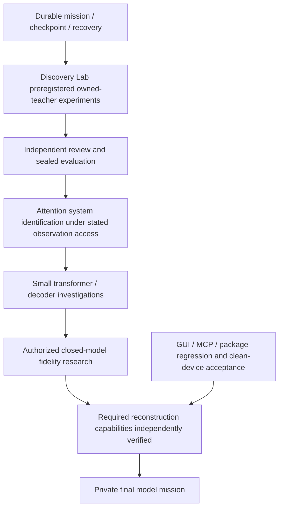

# ModelForge dependency roadmap

This is an unresolved research mission, not a promised universal algorithm. Stable baseline: v0.2.0, tag 952450a; accepted engineering and explicit limitations are in acceptance-v0.2.0.he.md. Experimental branch: discovery-lab. Private final model creation is BLOCKED by the user's prerequisite, not by a temporary missing button.

Priority queue:

1. Durable state/append-only ledger: crash recovery, lock ownership, Git ancestry, no automatic execution of persisted command strings. Verify before using it as a scientific source of truth.
2. Discovery Lab: separate teacher preparation, allowed learner observations, fixed validation, one-time sealed heldout evaluator, model/source commitments. Start with nonlinear quadratic families, richer real-valued observations and insufficient sign-only controls. No claim of transformer reconstruction.
3. Independent verification agent: challenge leakage, seed exposure, repeated evaluation, fabricated independence, numerical exactness and resource assertions.
4. Advance to known small attention mechanisms: characterize Q/K gauge symmetries, rank and observation requirements. Pre-register comparison of output-only vs legitimately exposed activations; never assume arbitrary text endpoints expose logits.
5. Improve actual MLX full-prefix baseline through bounded KV-cache experiments. Compare exactly the same tokenizer, model, decoding, seed, warmup, numerical error, tokens/sec and sampled RSS. No new large model download or heavy training until a discriminating experiment is designed.
6. Discovery/resume GUI and CLI/MCP integration; resource limits, cancellation and persistence. Independent GUI workflow tests; visible clean-device Gatekeeper remains unverified.
7. Heldout broad model evaluation/dataset provenance, then owned small transformer research, architecture families, nonlinear identifiability and permitted knowledge transfer. External target credentials, identity, license and spend authorization are explicit dependencies, not assumed access.
8. Image/video/audio and MoE only after language-model research infrastructure; not implemented by metadata inventory.
9. Private final model: BLOCKED. Target 'Luna 5.6' has no unambiguous provider/model ID/evaluation reference yet. No private weights or implementation will enter public Git. No benchmark parity or frontier label is justified. Gate cannot open on a passing software suite or a signed report alone; underlying scientific scope must actually be achieved and independently checked.

Scientific outcomes must be classified ENGINEERING COMPLETE / SCIENTIFICALLY PROVEN (under explicit assumptions) / RESEARCH IN PROGRESS / UNRESOLVED. Last two are not failures to be hidden. No scheduling or execution outside an active session is implied by this graph.
