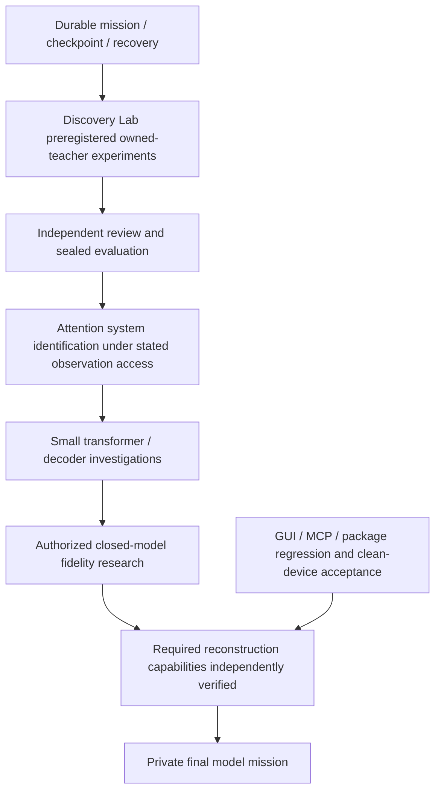

# ModelForge dependency roadmap

This is an unresolved research mission, not a promised universal algorithm. Stable baseline: v0.2.0, tag 952450a; accepted engineering and explicit limitations are in acceptance-v0.2.0.he.md. Experimental branch: discovery-lab. Private final model creation is BLOCKED by the user's prerequisite, not by a temporary missing button.

Priority queue:

1. Durable state/append-only ledger: crash recovery, lock ownership, Git ancestry, no automatic execution of persisted command strings. Verify before using it as a scientific source of truth.
2. Discovery Lab: separate teacher preparation, allowed learner observations, fixed validation, one-time sealed heldout evaluator, model/source commitments. Start with nonlinear quadratic families, richer real-valued observations and insufficient sign-only controls. No claim of transformer reconstruction.
3. Independent verification agent: challenge leakage, seed exposure, repeated evaluation, fabricated independence, numerical exactness and resource assertions.
4. Advance to known small attention mechanisms: characterize Q/K gauge symmetries, rank and observation requirements. Pre-register comparison of output-only vs legitimately exposed activations; never assume arbitrary text endpoints expose logits.
5. Improve actual MLX full-prefix baseline through bounded KV-cache experiments. Compare exactly the same tokenizer, model, decoding, seed, warmup, numerical error, tokens/sec and sampled RSS. No new large model download or heavy training until a discriminating experiment is designed.
6. Discovery/resume GUI and CLI/MCP integration; resource limits, cancellation and persistence. Independent GUI workflow tests; visible clean-device Gatekeeper remains unverified.
7. Heldout broad model evaluation/dataset provenance, then owned small transformer research, architecture families, nonlinear identifiability and permitted knowledge transfer. External target credentials, identity, license and spend authorization are explicit dependencies, not assumed access.
8. Image/video/audio and MoE only after language-model research infrastructure; not implemented by metadata inventory.
9. Private final model: BLOCKED. Target 'Luna 5.6' has no unambiguous provider/model ID/evaluation reference yet. No private weights or implementation will enter public Git. No benchmark parity or frontier label is justified. Gate cannot open on a passing software suite or a signed report alone; underlying scientific scope must actually be achieved and independently checked.

Scientific outcomes must be classified ENGINEERING COMPLETE / SCIENTIFICALLY PROVEN (under explicit assumptions) / RESEARCH IN PROGRESS / UNRESOLVED. Last two are not failures to be hidden. No scheduling or execution outside an active session is implied by this graph.

## 2026-10-24 main-platform update

The isolated continuous-query antipodal **even component** route is implemented and sealed-tested, with an explicit failing bias control and independent protocol review. See docs/antipodal-reconstruction.md. This stronger observation access is not implied by O3 data or final text/logits. Full gate/coupling discovery, odd component, attention composition and arbitrary-model recovery remain open. Preserve the sealed SwiGLU v1 failure; preregister iteration-budget v2 before fresh teachers. Historical private-model work does not open the final prerequisite.

Isolated GLU full-map development now has a positive owned width64/d32 pilot, independent multiscale checks and explicit quartic-flatness diagnosis. Advance to preregistered fresh-teacher replication before integration. Keep O3 finite observations, isolated continuous queries and final text/logits as distinct access regimes. This changes the next experiment, not the universal objective or closed private gate.

Fresh isolated GLU v1 failed engineering before sealed evaluation (stdout/file contract). Preserve the failed run and do not infer scientific failure from initial direction counts. V2 keeps methods/thresholds fixed and adds tested transport; require independent source review and a newly committed readiness certificate before3fresh teachers. See docs/isolated-glu-sealed.md.

Actual v2 all3 criterion FAILED (63/64/64 candidates). Two fresh .2/.4teachers passed registered finite-domain/parameter criteria; .1stopped before truth evaluation. Candidate discovery completeness is now the measured bottleneck. Prioritize calibration-only residual/subspace-guided coverage research, followed by a new frozen protocol and fresh sealed evaluation. Full Transformer/universal reconstruction and private final-model gate remain unmet.

2026-10-24 candidate coverage development: a distinct calibration-only tangent/residual initializer produced one extra nonduplicate direction (63→64) using only saved public v2 teacher0 Hessians/directions, zero new queries. Original-subspace loss4.70e-17; no private teacher match or functional/heldout check. Independent geometry controls show that residual dimension/energy and a single tangent singular minimum cannot certify coverage. Source examples/isolated_glu/coverage.py; docs/isolated-glu-coverage.md; evidence experiments/evidence/isolated-glu-coverage-development-v1/. Three synthetic tests/types/lint pass. Formal v2 remains FAILED; no consumed labels reused. Next implement/review/freeze DISTINCT fresh-teacher v3 protocol; experiments/preregistrations/isolated-glu-fullmap-v3-rescue-draft.json is DRAFT/NOT READY. Private final-model gate remains CLOSED.

2026-10-25 v3 source/protocol ready for cross-platform checks: examples/isolated_glu/sealed_v3.py and experiments/preregistrations/isolated-glu-fullmap-v3.json are separate from frozen v2. Fixed63rescue/64skip/othersfail;128rescue starts, no new oracle calls. Base outputs, rescue outputs and branch are sealed; original-V losses and exact selection are recomputed. Independent source/protocol review closed two audit findings;9changed-path tests, strict mypy/Ruff passed. Evidence experiments/evidence/isolated-glu-v3-runner/. No fresh v3 teachers yet; run targeted12-test CI (v3+coverage), then committed readiness check before entropy. V2 FAILED remains unchanged; private final-model gate CLOSED.

2026-10-25 actual v3 FAILED: fresh teachers60/62/61directions, all rejected before63-only rescue/coupling/heldout.436320calibration/0sealed calls, sourcea0d0556; independent public negative-outcome audit completed. CI40162660787 passed12changed-path tests on each OS; no native rebuild. Separate multi-direction public-calibration development then obtained60→64,62→64,61→64 in one fixed512start round each (3.72/3.39/3.23s, sampled RSS≤104972288bytes). All candidates/initializations/selection independently audited; no private truth/heldout. Frozen multiscale solver integrated on public observations, finite rank-one outputs and calibration consistency audited. Two NEW local synthetic tests/types/lint pass for coverage_multi.py; that new script has no cross-platform CI yet. Formal v3 remains FAILED;64counts/calibration fit do not certify true coverage/fullmap. See docs/isolated-glu-multi-coverage.md and experiments/evidence/isolated-glu-multi-coverage-development-v1/. Next implement/review/freeze DISTINCT v4 multi-rescue wrapper; experiments/preregistrations/isolated-glu-fullmap-v4-multi-draft.json is DRAFT NOT READY. Private final-model prerequisite CLOSED.

2026-10-25 v4 frozen source/readiness: sealed_v4.py adds fixed1..63multi/64skip to frozen coverage_multi.py, max4roundsx512starts. Every round's prefix/losses/merge/seeded starts/report geometry and inventory audited; final64required with no truncation. Independent review approved after closing geometry-report gap,2/3/4round synthetic audit probes passed;15local changed-path tests/types/lint passed. Source/protocol/review/readiness must be committed unchanged before entropy. Run targeted17test v4+multi CI on3OS, then new3teacher v4 once. No fresh v4 teachers yet; v1/v2/v3 failures preserved, private final-model prerequisite CLOSED.

2026-10-25 actual v4 PASSED all3registered finite-sample criteria on fresh owned isolated FP64 SwiGLU blocks. Base61/60/62→64 each via one512start multi-rescue round;436320cal+6144sealed=442464vectorcalls;26.0751scontroller, maxsampled348717056bytes (~332.56MiB). Max scale-group Frobenius relative error1.1527661335e-4; maxabsolute9.0871620648 is retained. Independent public outcome audit verified commitments, public fit audit and numeric threshold logic without rereading private labels or refitting. Sourcefad2ffe, CI40163909186 passed17changed tests each3OS. See docs/isolated-glu-v4-result.md and experiments/evidence/isolated-glu-fullmap-v4/. This is3isolatedd32/width64/out32bias-free FP64 cases, not universal/fullTransformer/originalstoredweight/allinputs proof. Oldfailures preserved and consumedlabels maynotbeusedagain. Next deliver actual packaged glu32 candidate backend/CLI/MCP and installed skill route; plan docs/superpowers/plans/2026-10-25-glu32-candidate-backend.md. The fullGLU experimental Python path is NOT YET a supported backend/MCP operation. Subsequent precision/access/scaling research remains open; private final-model gate CLOSED.

2026-10-25 packaged GLU32 delivery COMPLETE (component engineering only): source84ce720, independently reviewed pure-NumPy kernel/strict IO/bounded worker/service/CLI/MCP/reload/export. Actual clean installed-wheel CLI/MCP passed without PYTHONPATH/heavy engines; independent installedCLI17newpublic inputs matched frozen public candidate exactly. Local25tests and CI40167761243 each Linux/macOS/Windows25passed,0failed,0error,0skip, plus changed-source types/lint. No native rebuild/new stable release/GUI verification. Rejected operations cannot predict/export; accepted artifacts bound to success-record manifest hash. Installed and bundled skills synchronized/validated. Exact contract skills/model-forge/references/glu32.md; engineering/evidence docs/glu32-candidate-backend.md and experiments/evidence/glu32-candidate-backend/. Candidate flags remain uncertified; this ports prior finite isolated FP64 v4 science, not new sealed proof. Next preregister finite-precision/rounding step-size tradeoffs, bias controls, dimension/width/HVP scaling and missing final-output-to-block reduction. O3 iteration-budget study remains separate. Consumed labels/private assets untouched; universal reconstruction unresolved and private final-model gate CLOSED.
